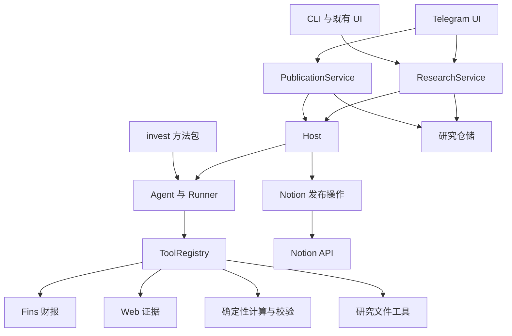

# alpha 投研系统设计

alpha 是由 Host 托管的通用投研 Agent。Telegram 提供按研究话题组织的入口，invest 提供方法，Fins 提供财报能力；研究成果先在本地形成不可变版本，再按用户指令发布到 Notion 的 Invest 页面下。

本文定义目标设计，包与入口正迁移至 alpha，具体完成状态以实施计划为准。实施任务、状态和验收证据以 [program.md](program.md) 为准，目标接口尚未实现。

## 1 范围与成功标准

用户能够创建多项研究，在 Telegram 切换研究话题，提交文字、链接和文件，查看进度、停止执行、取得带来源的报告，并将指定版本推送到 Invest。重启后研究、消息绑定和发布记录可恢复；重复消息、按钮和受理重试不会重复启动同一请求或重复发布已确认版本。

研究覆盖个股、公司比较、行业与事件、估值、财报解读和论点更新。首版使用一个研究 Agent 和一套 invest 方法包；每项研究同时只允许一个会话写执行，不同研究受 Host 总并发额度约束。现有固定章节写作继续作为专门业务路径。

工程包括产品、Python 包、命令、配置和运行状态路径改名。交易执行、定时监控、全市场扫描、Telegram 群协作、Mini App、任意 Python 代码执行、Notion 双向编辑合并另立需求。

## 2 命名与一次性升级

| 对象 | 目标 |
|---|---|
| 产品名 | alpha |
| Python 包 | alpha |
| 分发元数据名 | alpha-agent；本工程构建本地分发，公共仓库名称可用性在实际发布时核实 |
| 主命令 | `alpha` |
| Telegram 入口 | `alpha telegram run` |
| 既有独立入口 | `alpha-web`、`alpha-wechat`、`alpha-render` |
| 隐藏状态目录 | `workspace/.alpha/` |
| Host 数据库 | `workspace/.alpha/host/alpha_host.db` |
| 渠道凭据 | 默认复用 Codex config.toml 对应 MCP 服务 env；无 Telegram 连接时读取 Codex 用户目录内 alpha/credentials.toml；`ALPHA_TELEGRAM_BOT_TOKEN`、`ALPHA_NOTION_TOKEN` 为显式覆盖 |

包目录、导入、工具 registrar、构建和安装脚本、测试、CI、配置及当前使用文档同时更新。已有项目专属环境变量按清单改为 ALPHA 前缀，业务命令保留功能语义。历史研究原文、第三方品牌和来源 URL 不做全局替换。工作目录和 Git 远端不因产品改名自动移动。

`alpha init` 是旧工作区升级唯一入口：

1. 探测新旧布局并取得初始化排他锁，确认相关进程已停止；无法确认时拒绝迁移并说明占用，不自动终止进程。
2. 对 SQLite 使用一致性备份并处理 WAL，记录迁移日志，不在活跃写入期间裸复制数据库。
3. 通过 workspace_migrations 插件将旧隐藏目录、数据库名、已知配置及可恢复快照内的包路径转换为当前布局。
4. 创建全新研究 schema；Host schema 因持久受理而变化时，同一升级链显式转换旧 Host 数据。新研究表原本不存在时不制造历史数据。
5. 校验 Session、Run、会话归档、Fins 数据和既有渠道状态，再标记完成。重复 init 为无操作，中断可按日志继续或恢复备份，新旧布局冲突明确失败。

运行时只读当前布局/schema，不保留旧名导入、命令 alias、兼容 re-export 或隐式回退读取。升级属于本需求明确要求的一次性迁移。

## 3 架构与职责



稳定分层继续为 UI → Service → Host → Agent。Notion 发布是 Host 托管的 direct operation。仓储、工具和方法包是能力组件，不新增架构层。

| 组件 | 职责 |
|---|---|
| Telegram 适配器 | Bot API、协议解析、消息与按钮展示、话题/message ID；通过 Service 管理研究 |
| ResearchService | 问题和截止时间、研究生命周期、访问检查、输入队列、Session 映射、ExecutionContract、报告版本提交 |
| PublicationService | 接受针对指定版本/目标的发布意图、持久化发布记录、请求 Host 执行和读取结果 |
| Host | 持久受理、Session/Run、会话写互斥、取消、超时、总额度、恢复和 direct operation 生命周期 |
| Agent/Runner | 消息循环、模型和工具交互，不决定外部发布权限 |
| invest | 研究路由、方法、证据和数字契约、反证与成文要求 |
| Fins | 文档获取、处理、搜索与结构化财报读取，原件访问只走其 storage 协议 |
| research/storage | 研究、版本、证据、文件与发布记录的窄持久接口 |
| integrations/notion | 实现发布端口与 HTTP 协议，不反向依赖具体 Service 或 Telegram |

ResearchService 复用现有 scene 接受与 contract preparation，不增加只透传 ChatService 的包装。Notion 客户端通过端口注入，其操作由 Host 托管；Host 不导入 Notion 业务实现。下层协议不携带 Telegram DTO、研究聚合或上层具体类。

## 4 研究身份、状态与数据

### 4.1 身份

| 身份 | 用途 |
|---|---|
| research_id | 持续存在的一项问题驱动研究，跨多轮和多份报告 |
| session_id | Host 会话治理身份，首版与 research 一对一 |
| run_id | 一次研究交互或发布操作，由 Host 分配和推进 |
| revision_id | 已提交且不可变的一份研究报告版本 |

股票代码是研究对象，不是 Session 唯一键。同公司不同问题独立研究，跨公司比较也可成项。生成报告只结束对应 Run，不自动关闭研究或 Session。

Telegram 的 `(bot_id, chat_id, message_thread_id)` 唯一定位 research_id，再解析 Session；同时校验操作者 user ID。根会话普通消息引导新建或选择话题，不按最近股票名猜测。旧按钮始终引用原研究与原版本。

### 4.2 最小持久模型

| 数据 | 主要字段及不变量 |
|---|---|
| Research | research_id、owner_id、title、question、subjects、as_of、depth、session_id、state、version、created_at、updated_at；状态 ACTIVE/ARCHIVED |
| ResearchTurn | turn_id、research_id、request_key、sequence、input、attachment_refs、state、run_id；研究内 request_key 唯一，sequence 单调 |
| ResearchRevision | revision_id、research_id、parent_revision_id、source_turn_id、source_run_id、as_of、artifact_refs、content_hash、skill_hash、created_at；提交后不可变 |
| Evidence | evidence_id、source_ref、document_type、published_at、available_at、accessed_at、locator、excerpt、classification；时间未知保留原因 |
| Finding | 版本化研究记录中的结论、证据 ID、推导、反证和失效条件；首版不建论点图数据库 |
| ChannelBinding | channel、account_id、conversation_id、thread_id、research_id、provisioning_state；渠道地址和 research 唯一绑定，Telegram 适配器负责映射其协议 ID |
| ChannelInbox | bot_id、update_id、input_kind、received_at、processing_state、request_key；原始协议仅供内部审计，业务参数显式类型化 |
| Publication | publication_id、revision_id、target_id、content_hash、state、run_id、page_id、page_url、remote_task_id、lease_id、error、retry_at；revision/target 唯一 |
| ArtifactDelivery | delivery_id、revision_id、channel_target、artifact_hash、state、remote_message_id、error；附件不塞进文本 reply_content |

数字沿用 invest data contract：值、单位、币种、期间、会计/估计口径、来源、事实/指引/共识/假设分类、缺失原因。关联计算保存公式与输入 ID。Evidence 引用 Fins 文档和章节标识，不复制一套财报仓储。

research.db 存研究、待派发输入、绑定、版本与发布记录；Host 状态仍归 Host 仓储。跨两者通过稳定受理键恢复，不使用跨层 SQL，也不假设两库同时提交。

ChannelInbox、轮询 offset、按钮 token 和消息回执存于 Telegram 自有的 channel.db，经渠道仓储访问；ResearchService 只接收共享契约中的渠道地址和操作者身份，不接收 Telegram 原始 DTO。research_id 先持久生成，再使用稳定会话键通过 Host 的幂等会话入口创建/取得 Session，避免创建中断产生第二个会话。

研究请求明确提供 as_of 时固定该截止时间；未提供时，每次受理记录服务器当前时间为该轮截止。Research 保存用户的默认截止策略，ResearchTurn 与 Revision 各自保存最终接受的 as_of；更新研究不会改写旧版本截止时间。

### 4.3 顺序、停止与归档

ResearchTurn 是尚待派发的业务输入；Host pending turn 是已经受理的可恢复执行。Service 先持久化输入，再以稳定 request_key 请求 Host 受理；崩溃后重复受理返回同一 run，Service 只存关联，不覆盖 Host 状态。

输入队列状态为 QUEUED → DISPATCHING → SUBMITTED → SETTLED，尚未受理的输入可进入 CANCELLED。SETTLED 只表示已观察 Host 终态并完成队列收尾，不复制成功/失败/取消判断。DISPATCHING 中断后以原 request_key 查找或重试 Host 受理；SUBMITTED 通过已关联 run_id 恢复观察，不重新创建执行。派发 claim 与研究内顺序在研究仓储内原子推进，Host 写互斥提供执行层最后约束。

同研究输入按 sequence 串行。执行中补充先排下一轮，明确回复“已记录，将在本轮结束后处理”；首版不宣称当前模型调用已经吸收要求。不同研究可并行，同 Session 写互斥必须跨实例和进程成立，不能只用实例级 asyncio.Lock。

“停止研究”取消当前研究执行和停止动作之前尚未启动的输入，保留文本/证据。通过 admission fence 标定停止边界，之后新提交的消息不被误删。Host 确认收敛前显示“正在停止”。

归档只在无活跃研究执行和待执行输入时原子完成；繁忙时提供先停止再归档。归档保留 Session 和文件，重新打开后继续。归档不调用会不可逆关闭 Session 的 cancel_session。

## 5 invest 与研究闭环

新增 research scene，初始加载 invest SKILL 入口，按问题读取 references。Mode A/B/C/D/E 是同一 Agent 组合使用的分析视角，Quick/Standard/Full/Monitoring 保持原技能路由，不编码为固定章节服务链。

方法包保持 SKILL.md、references、scripts 结构，并携带实际引用的 writing 等依赖。构建检查引用可达，运行期只读。方法内容与资源清单 hash 纳入执行/版本快照；恢复已受理执行使用原快照，方法更新只影响后续执行。分发不依赖开发机绝对路径。

| 工具域 | 首版能力 |
|---|---|
| fins | 既有财报仓储和 FinsToolService |
| web | 搜索、正文和外部证据，来源内容不改变运行权限 |
| doc/skill | 只读已授权方法包、用户材料和当前研究文件 |
| research | 保存当前研究证据、笔记、计算输入和报告草稿；作用域由 Host 注入，模型不能传任意 research_id 越界 |
| calculation | invest 已有确定性脚本的白名单任务、强类型输入、Host 取消与超时 |

优先复用现有 HTTP 和标准库，不为连接 Telegram/Notion 引入 SDK。计算脚本依赖先盘点。validate_invest_data.py 需检查 JSON 的 status=pass，退出码 0 不代表通过。校验失败可以形成带明确缺口的文字研究，失败模型不能被标记为可复算、已校验模型；来源支持与投资推断仍需证据审查。

执行路径为“接受问题 → 经营机制与争议 → 证据和反证 → 必要计算 → 判断和失效条件 → 交付”。商业理解请求可不估值，量化缺口不取消仍可完成的经营分析。

报告由草稿形成候选快照，通过适用数据校验和引用检查后提交 revision。新报告引用父版本并记录变化说明；已提交证据在停止或异常后保留。只有提交后的版本可发布，发布不重新调用模型改写正文。

## 6 Telegram UI 与协议

### 6.1 研究管理

Telegram 原生话题列表用于切换研究。Bot 根会话的“我的研究”消息负责状态汇总、分页、检索和归档过滤。首版不依赖未验证的私聊话题深链；用户从原生列表进入话题，汇总卡片可直接显示摘要或发送报告。

```text
alpha · 我的研究

进行中
腾讯 · 资本开支与股东回报
正在核对现金流口径
[查看进度] [停止]

已有报告
腾讯与网易 · 游戏业务比较
报告 v2 · 已推送到 Invest
[查看摘要] [获取报告] [打开 Notion]

[新建研究] [活跃研究] [已归档]
```

报告卡片示意：

```text
研究完成 · 资本开支与股东回报 · v2
核心判断、关键依据、反证和待核验项……

[查看证据] [完整报告]
[检查反方] [更新研究]
[推送到 Notion]
```

点击推送即授权发布按钮绑定版本，不重复确认。显示“待推送 / 正在推送 / 已推送 / 推送失败 / 正在核对结果”；成功返回页面链接。v3 出现后，旧 v2 按钮仍发布 v2。

控制命令为 `/start`、`/help`、`/new`、`/researches`、`/status`、`/stop`。归档、更新与发布主要用按钮。文本“把这份报告推送到 Notion”解析为显式 revision/target 请求，仅有版本歧义才追问。

### 6.2 接收、绑定与交付

首版长轮询，复用现有 HTTP 依赖，每个 Bot 一个接收实例锁。整批更新先写 durable inbox，再推进 getUpdates offset，随后独立派发；研究耗时不阻塞收信。以 bot_id/update_id 去重，以稳定 request_key 受理；重复 callback 返回现状。

话题创建先保存 provisioning 操作。收到 thread_id 并落库后才能执行研究；响应丢失进入待核对，结合服务消息和后续话题输入确认，不按同名猜测或盲目重建。仍无法确认时，用户在目标话题显式绑定，Service 验证所有权和唯一约束。

按钮携带短操作 token，服务端解析动作、研究和版本，校验 sender/chat/thread、过期和记录版本。凭据只从部署配置注入，不进入模型、报告或日志。

阶段消息更新同一张进度卡；普通回答可用流式草稿，最终摘要必须正式发送。Telegram 文本显式转义，长报告用文件，限流按服务端提示退避。进度展示已完成阶段，不展示虚构百分比和完整内部 reasoning。

文字摘要复用 reply outbox。附件独立使用 ArtifactDelivery：先保存意图，成功记录 message_id。Telegram 发送不具有本应用可依赖的端到端 exactly-once 保证，响应丢失标记结果未知，避免无界重发；已知 message_id 的编辑可重试。研究完成、摘要送达、附件送达分别显示。

### 6.3 文件输入

记录元数据和下载状态，校验实际大小与配置上限，保留原名/MIME。财报经 Fins 上传/处理进入仓储，一般研究材料存 research 仓储；通用文件工具不绕过 Fins 路径读取财报。超限、损坏或不支持格式给明确原因和链接入口。

新材料形成后续输入和新 revision，不覆盖旧引用。语音转录和图像 OCR 是后续能力，收到附件不等于完成内容提取。

## 7 Notion 推送到 Invest

### 7.1 固定目标与授权

已只读核实目标为 [🌾 Invest](https://www.notion.so/8b6f0c8fc1264555b531281fbb0b96bc)，父页面 ID 为 `8b6f0c8f-c126-4555-b531-281fbb0b96bc`，其中包含近期投研报告。其他 Prompt/INVEST 和 Prompt/Invest Research 是模板页，不作为目标。

配置保存该稳定 ID，不在每次发送时搜索同名页。首版直接在 Invest 下建报告子页，不重排原有内容，不先建数据库或公司层级。

部署程序默认复用本地 Codex `mcp_servers.notion.env.NOTION_TOKEN`，支持 `NOTION_API_KEY` 或显式 ALPHA_NOTION_TOKEN 覆盖。凭据不复制到工作区；已验证当前保存的 token 可读取 Invest，写入仍遵守用户显式版本意图。ChatGPT 登录凭据不作为 Notion/Telegram token 使用。

默认按钮或明确指令触发。自动/定时发布、任意目标选择另行显式启用。权限检查位于 Service，Agent 无通用 Notion 写工具。

### 7.2 页面与版本

```text
Invest
├── 腾讯资本开支与股东回报 2026-10-24 v1
├── 腾讯资本开支与股东回报 2026-11-15 v2
└── 腾讯与网易游戏业务比较 2026-10-25 v1
```

以上为命名示例。每个不可变 revision 对应一个子页，新结论建新页并引用前一已发布版本，保留当时信息截止时间。内容包括研究问题、对象、正文、数据口径、证据/反证、变化说明、来源和必要计算，章节按问题组织。

页脚保留调和所需 publication 标识及版本来源；本地路径不作为远端可访问的来源链接。PDF/模型完成生成及上传后才附远端链接。同 revision 再次点击返回原 URL，改正文须新 revision，人工编辑过的已发布页不被后台覆盖。

### 7.3 最小实现与恢复

优先用 Notion 官方 Markdown API 创建和回读，固定已验证 API 版本，首版用稳定默认语法，表格做必要格式转换。不开发通用全类型 block 引擎。

普通报告单请求写完整正文；超出已验证限制才按确定章节拆分，保存段序与内容 hash。使用官方异步写入时保存 task 标识，轮询到明确完成并回读，202 不视为发布成功。

Publication 唯一键为 target_id/revision_id，同时核对固定 content_hash。

```text
PENDING → PUBLISHING → PUBLISHED
                  ├→ FAILED_RETRYABLE → PENDING
                  ├→ FAILED_TERMINAL
                  └→ RECONCILING → PUBLISHED / 保留待核对
```

发布过程：

1. Service 验证已提交版本、目标和操作者，持久化发布意图。
2. 消费者经 Host direct operation 受理，取得租约，读取固定快照发送。
3. 保存 page_id/URL 或 async task_id，回读确认父页、publication 标识、关键内容、引用及表格后才记 PUBLISHED。
4. 明确无副作用或可安全重试的临时故障按 Retry-After 和有界策略重试；鉴权、权限和非法正文保持明确失败。
5. 创建丢响应、超时或崩溃进入 RECONCILING。已知 page_id 直接回读，否则从配置父页候选子页核对 publication 标识；唯一匹配则关联，多匹配报告冲突。未查到不等于未创建，不自动再发 create。
6. 分段不确定时核对远端已存在段和预期内容后再补写，不凭本地 cursor 重复 append；人工修改、截断或无法确定前缀则停止自动改写。

本地租约只约束本地消费者，不能把外部 API 变成事务。旧请求结果未知时，即使租约过期，新消费者也只能调和，不能直接重复创建。Notion 失败不触发重新研究；“研究完成”和“发布成功”分别展示。

回读要验证所有预期章节、证据链接和表格内容覆盖，不能仅因页面存在或标题匹配而成功；返回截断、unknown 内容或正文缺段时继续核对或明确失败。Markdown 的格式归一化允许展示差异，本地 content_hash 固定发布输入，远端以内容完整性核对而不强求原始字节相等。

## 8 Host 执行契约

当前 Agent 流在消费生成器时才注册 run，不能把返回流句柄当作 durable 受理。增加窄受理入口：返回 accepted submission 前，以显式 request_key 持久化 run 和恢复输入；相同 key 返回同一 run。执行、事件订阅和结果查询与受理解耦，request_key 不放 metadata。

受理同时保存规范化输入摘要；相同 key 携带不同问题、权限、方法快照或截止时间时返回类型化冲突，不能静默复用旧 run。未显式给截止时间的重试复用首次接受的时间，不重新取时制造假冲突。

相同幂等受理原则也用于 direct operation 的显式 HostedRunSpec，发布队列重试不会因 Host 已受理而重新生成第二个运行记录。

Run 与 accepted pending 的一致性由 Host 事务保证，inbox 到 Host 靠稳定键恢复。Service 的运行读模型从 Host 查询，避免另一套 Run 状态机。

同 Session 写执行由 Host 跨进程串行，Service 队列保证输入顺序。取消覆盖排队、模型、工具和资源释放。新研究路径不创建额外父子 workflow；既有写作若创建子执行，补齐父作用域取消与注册竞态，不能以重复 Service 检查代替。

发布读取不可变版本，不取得会话写互斥，可与后续研究并行，使用独立 publication lane；研究停止和发布停止分别定位对应 run，避免停止研究时误取消另一项已明确提交的发布。

线程工具仍是协作取消，停止状态需反映实际收敛；计算 subprocess 应可回收。主动停止的请求不在重启后自动恢复。异常中断按持久输入重新准备或恢复，不能承诺从模型内部位置继续。

## 9 物理布局与实现落点

```text
workspace/
├── .alpha/
│   ├── host/alpha_host.db
│   ├── research/
│   │   ├── research.db          # 目录、队列、工作笔记/计算/草稿、版本、绑定
│   │   ├── methods/<hash>/     # 不可变方法代码与全部参考
│   │   └── artifacts/<research_id>/revisions/<revision_id>/
│   │       ├── report.md
│   │       ├── evidence.json
│   │       ├── data-contract.json  # 无契约时内容为 null
│   │       ├── metadata.json
│   │       └── sha256
│   └── telegram/channel.db      # 渠道持久状态；同目录有实例锁
├── config/                      # 保留既有配置覆盖机制
└── 既有财报目录                  # 只经 alpha.fins.storage 使用
```

工作日志使用 SQLite 原子追加，工具调用 ID 去重并保留接受序号；正式版本引用原输入与 Run，可追溯其计算记录。版本以临时目录、hash 和原子提交落盘，数据库只发布完整目录引用。未引用目录可盘点恢复，已引用文件缺失明确报损坏，不静默回退旧报告。sha256 校验版本文件完整性，研究状态/latest 指针以数据库为真源。

目标落点为 alpha/contracts/research.py、publication.py，alpha/services/research_service.py、publication_service.py，alpha/research/{domain,storage,tools}，alpha/integrations/notion/，alpha/telegram/，以及现有 host/prompting/config/cli 的必要改动。

新增模型强类型、枚举、显式参数和中文文档，外部 JSON 在边界解码。不创建 ServiceRegistry、通用工作流、超级运行时对象，也不借改名重写 Fins/Engine 算法。

## 10 运维与验收

最小部署为一个常驻 Telegram 长轮询进程，启动 Service 队列消费，实际操作均进 Host。重启先检查 schema 和迁移，调和 Host orphan/pending，再恢复 inbox、话题创建、附件和 Notion 待核对任务。未配 Notion 时研究仍可用，推送入口明确提示配置缺失。

日志以 research/revision/run/update/publication ID 关联，不含密钥；关注积压、无主 run、停止未收敛、未知交付结果及发布待核对。首版个人私聊用配置的 user ID 白名单，Bot token 不代表用户身份。

关键验收场景：

- 同公司两研究及跨公司比较互不串话，客户端重开和服务重启后绑定稳定；
- update 重放、受理后崩溃、按钮双击不重复已确认工作；
- 同研究跨实例串行，不同研究按全局 lane 并行；
- 排队、注册、模型和工具阶段停止，状态/permit/后台资源均收敛；
- 财报上传经 Fins，证据定位及数字口径可追溯，缺失数不变为 0；
- 校验器 exit=0/status=fail 不被误认为通过；
- v1/v2 独立，旧按钮发布旧版本，父页是准确 Invest；
- 创建成功但丢响应、分段中断、异步失败、无权限、限流分别处理；
- 既有 CLI/Web/WeChat/Fins 回归、构建及 README 安装路径使用 alpha 命名。

每项实现激活 .venv 后运行受影响测试和 pyright，修改文件覆盖率目标 ≥80%（项目已有目录豁免照旧）。README 在实现验证后按职责更新，不提前把目标设计写成当前功能。完整任务见 program.md。

## 11 依据与待落实条件

当前代码依据：[ChatService](../../alpha/services/chat_service.py)、[执行契约](../../alpha/contracts/agent_execution.py)、[HostExecutor](../../alpha/host/executor.py)、[文本 outbox](../../alpha/contracts/reply_outbox.py)、[迁移入口](../../alpha/cli/workspace_migrations/runner.py)、[WeChat 渠道](../../alpha/wechat/daemon.py)。命名迁移任务更新这些链接。

方法依据为本会话读取的 invest SKILL、Mode A、data-contract 和 scripts；实施时将其及实际跨 skill 引用打包为可移植资产。

外部协议核对日期为 2026-10-24：

- Telegram 私聊话题需 BotFather 开启：[Bot Features](https://core.telegram.org/bots/features#topics-in-private-chats)。
- 流式草稿是临时预览，正式留存需单独发送，停止事件进入 Host：[sendMessageDraft](https://core.telegram.org/bots/api#sendmessagedraft)。
- 入站 offset、按钮与文件限制按固定契约和实测实现：[Telegram Bot API](https://core.telegram.org/bots/api)。
- Notion 支持 Markdown 创建/读取/更新及可选异步写入：[Working with Markdown](https://developers.notion.com/guides/data-apis/working-with-markdown-content)。
- 发布队列根据服务端 Retry-After 处理限流/过载：[Notion Request Limits](https://developers.notion.com/reference/request-limits)。

部署复用本地 Codex 登录及保存的渠道配置。当前已完成真实 Codex 研究/取消、保存的 Notion 凭据读取 Invest 与本工作区 --codex 初始化；Telegram token 已保存到 Codex 用户目录的 alpha 专用凭据，真实身份读取通过；Bot 私聊话题未开启，允许的 user ID 尚未提供，这两项阻塞真实交互。环境与离线基线已建立，最新证据见 program.md 和 acceptance.md。公共包发布、远端仓库改名和生产部署不包含在本次设计交付。

## 本地 Codex 运行边界

research 默认 `codex-local`；`alpha init --codex` 明确将工作区全部 scene 切到本地运行器并跳过 API Key 向导。原生登录、默认模型和推理配置交给 Codex CLI 管理；app-server 经 stdio 连接，每个 Host Run 使用临时原生线程，Host 历史决定恢复上下文，不使用全局最近会话。

动态工具逐批产生既有 Engine 事件，工具执行仍注入同一 Host Run/iteration/tool_call 和取消令牌，每批回到 alpha Agent 进行迭代与失败治理。原生 shell、外部 MCP、应用和多 Agent 关闭，旁路或权限请求明确失败。真实管道取消会终止并回收独立进程组。协议依据：[Codex app-server](https://learn.chatgpt.com/docs/app-server)。
