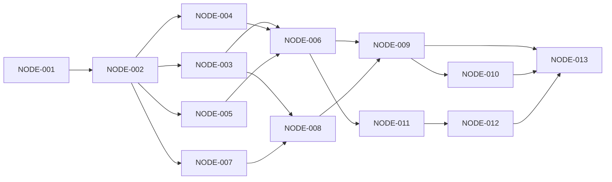

# Program: alpha 投研系统改造

- Overall status: `阻塞`
- Profile: `Lite`
- Active plan node: `NODE-021`
- Owner: `项目维护者与实施代理`
- Last updated: `2026-10-25`
- Clean state: `Not due`
- Last clean: 2026-10-25 / workspace/tmp/alpha-validation/analysis-plan-validation.txt

## Outcome

- Problem: 当前财报系统需要扩展为通用研究，接入 Telegram 多研究管理及指定版本 Notion 发布，并统一改名 alpha。
- Success: 在 Telegram 或外部 coding agent 创建和继续同项研究；股票研究实际使用 Fins 结构化报表，报告经候选稿校验后形成不可变版本，并按研究主题归档至 Invest；停止、断线和重启可恢复。
- Collaboration intent: 用户已确认自主实施全部设计；阶段汇报后继续，不以文档或局部实现代替完成。
- Non-goals: 不做公共发布、Git 远端改名或生产部署；不含交易、定时监控、通用 workflow、群协作与双向编辑合并。Notion 写入限于 Invest 下本次 BABA 正式主题/版本及明确测试页。

## Constraints

- Strategic defaults: 遵守 AGENTS.md；UI → Service → Host → Agent，Host 为生命周期真源，财报只经 Fins storage，强类型与中文文档，不保留兼容导入/别名。
- Tactical objective: 最小完整路径验证单 Agent + invest + 可追溯证据 + Telegram 多研究 + Notion 显式发布。
- Imperative bounds: schema 按新设计起库；旧路径和 schema 仅通过 workspace_migrations 插件进入 alpha init 一次性升级，运行时不兼容读。实现后激活 .venv 跑受影响测试、pyright、覆盖率和职责相关 README。
- Negotiable space: 窄仓储物理拆分、HTTP 封装及 fixture 组织可按现有模式调整，不扩大框架层级。
- Material assumptions: alpha 覆盖产品/包/CLI/配置/隐藏目录；个人私聊为首版；Notion 用按钮或明确指令触发，每个报告版本独立子页。
- Active unknowns: 实施时需真实 Bot、user ID、话题开关和独立 Notion connection 的 Invest 写权限。已保存 Notion token 经真实只读确认可复用；Telegram 身份已验证，私聊话题开关与用户白名单待用户完成。公共分发名称可用性在实际发布时检查。
- Escalate when: Invest 目标变化、外部协议不能支持已接受交互、旧数据无法无损迁移，或实施需要突破边界。继续独立任务，准确标明受影响项。

## Acceptance

| ID | Condition | Verification | Pass condition |
|---|---|---|---|
| A-001 | alpha 命名与一次性升级完整 | NODE-002 新安装和旧工作区 fixture | 新入口可用，旧数据保留，二次 init 无额外变更 |
| A-002 | 多研究独立可恢复 | NODE-003/008/009 跨实例跨重启场景 | 同公司问题不串话，绑定和归档/打开正确 |
| A-003 | Host 持久受理及停止闭环 | NODE-004/006 重放和竞争测试 | 同请求同 run，跨实例会话串行，停止资源收敛 |
| A-004 | invest 成果可追溯和复算 | NODE-005/006/010 研究 fixture | 依赖可达，原文定位/口径/反证/计算可核对 |
| A-005 | Telegram 多研究和附件可用 | NODE-007/008/009/010 mock 与真实私聊 | 更新不丢，按钮不越权，进度与文件投递正确 |
| A-006 | 指定版本发布正确 Invest | NODE-011/012 回读及故障注入 | 双击同页，旧按钮不发新版本，未知结果先调和 |
| A-007 | 交付和原有路径回归 | NODE-013 测试/类型/构建/用户旅程 | 适用回归通过，真实集成和离线验证分别记录 |

## Plan

任务状态只在此表维护，下文定义规格，不复制第二份状态。验证输出放 workspace/tmp/alpha-validation/，运行后将准确证据路径回写本表。

| Node | Status | Action | Verification | Evidence | Reflection |
|---|---|---|---|---|---|
| NODE-001 | `完成` | 开发环境与现状基线 | Python 3.11 环境；pyright 0 错；代理环境失败已直接定位 | workspace/tmp/alpha-validation/baseline-pyright.json、proxy-environment-probe.txt | None |
| NODE-002 | `完成` | alpha 命名和一次性工作区升级 | 全量 5211 通过；迁移专项覆盖率 96%；pyright 0 错；wheel 构建及新入口通过 | workspace/tmp/alpha-validation/renamed-tests.txt、migration-coverage.json、renamed-pyright.json、wheel-build.txt | None |
| NODE-003 | `完成` | 研究仓储、队列与版本 | 核心仓储/渠道绑定/持久停止边界已实现；发布/材料仓储和 Service 集成；最终 5520 项回归通过，版本与原件不可变 | workspace/tmp/alpha-validation/research-storage-tests.txt、research-bindings-tests.txt、stop-fence-tests.txt | None |
| NODE-004 | `完成` | Host 受理、互斥与取消 | 原子受理/幂等停止/执行领取/结果持久化已实现；353 项回归通过；新增模块覆盖率 93%–100%；跨进程探针及队列停止测试通过；Service 集成、持久显式恢复、无 Session 独立操作受理、较久接受进程退出保护已验证；父取消作用域已关闭晚注册竞争，专项 56 项通过 | workspace/tmp/alpha-validation/host-admission-coverage.json、host-process-recovery.txt、stop-fence-tests.txt、implementation-pyright.json | None |
| NODE-005 | `完成` | invest 方法包与工具 | 四种确定计算、42 份 Markdown 及哈希快照、可取消且有界的子进程执行已实现；研究测试 163 项通过，各新文件覆盖率 86%–100%，pyright 0 错；wheel 包含全部资源，独立环境 smoke 通过；七项研究工具及真实 research 场景装配已实现；材料导入和 Fins 结构准备已通过 | workspace/tmp/alpha-validation/research-runner-tests.txt、calculation-runner-pyright.txt、method-wheel-build.txt；tests/fixtures/invest/ | R-002、R-003 |
| NODE-006 | `完成` | CLI 完整研究闭环 | 创建/输入/执行/停止/版本读取/显式恢复已接线，真实 Service/Host 场景装配测试通过；模型流隔离，未作真实模型研究 | workspace/tmp/alpha-validation/research-resume-tests.txt、research-resume-pyright.txt、research-cli-smoke.txt | None |
| NODE-007 | `完成` | Telegram 接收与 inbox | 批量更新/offset 原子保存、跨重启重放、Bot 隔离、预检与实例锁、白名单；渠道新文件覆盖率均 >=80% | workspace/tmp/alpha-validation/telegram-complete-tests.txt、telegram-complete-coverage.json | None |
| NODE-008 | `完成` | 研究话题与绑定 | 原生话题、唯一绑定、随机创建标记与未知结果调和已实现，双研究/创建丢响应/重启测试通过；离线创建/调和验证完成；真实 Bot 待部署凭据 | workspace/tmp/alpha-validation/telegram-complete-tests.txt | None |
| NODE-009 | `完成` | 管理 UI、进度及交付 | 分页/检索/状态/停止/归档/打开、进度卡、摘要 outbox 与 Markdown 文件已接线；按钮目标与未知发送测试通过；Notion 状态及显式重试已接线；真实客户端待凭据 | workspace/tmp/alpha-validation/telegram-complete-tests.txt、telegram-complete-coverage.json | None |
| NODE-010 | `完成` | 材料导入与增量研究 | Telegram/CLI 导入、隔离/时间/取消/损坏验证、实际 Fins/Docling 解析、v2 不改 v1 全部通过 | workspace/tmp/alpha-validation/materials-fins-tools-tests.txt、materials-journey-tests.txt | None |
| NODE-011 | `完成` | Notion 指定版本发布 | 仓储、Service、CLI、Telegram 和独立 Host 操作完整接通；593 项专项回归通过，pyright 零错误；真实账号待凭据 | workspace/tmp/alpha-validation/publication-phase-tests.txt、publication-phase-pyright.txt | None |
| NODE-012 | `完成` | Notion 未知结果调和 | 创建丢响应/限流/异步/租约/退出收尾已有回归；固定分段、消耗哨兵、异步续写、过期任务与人工改动拒绝已通过 | workspace/tmp/alpha-validation/publication-owned-thread-tests.txt、segments-tests.txt | None |
| NODE-013 | `完成` | 全链验收与交付 | 5520 通过/6 跳过，pyright 零错误，wheel 独立安装与新旧工作区旅程通过；真实外部凭据未配置 | workspace/tmp/alpha-validation/alpha-final-required-tests.txt、alpha-final-pyright.txt、alpha-final-wheel-smoke.txt；docs/alpha/acceptance.md | None |
| NODE-014 | `完成` | 本地 Codex Agent 作为研究运行器 | 本地真实登录、材料读取/报告版本/取消通过；5536 项通过/6 跳过，pyright 零错误；新增文件覆盖率 >=86.9%；当前工作区 --codex 已配置 | workspace/tmp/alpha-validation/codex-live-research.txt、codex-live-cancel.txt、codex-full-tests.txt、codex-final-pyright.txt、codex-workspace-init.txt | R-007 |
| NODE-015 | `完成` | 复用 Codex 已保存连接凭据 | Notion 直接复用已有 token，不复制登录或连接密钥；当前工作区目标 Invest 真实只读验证通过 | workspace/tmp/alpha-validation/codex-notion-readonly.txt、codex-focused-tests.txt | None |
| NODE-016 | `阻塞` | Telegram 复用与联调 | 用户提供 token 后已存入 Codex 用户目录 alpha/credentials.toml（0600），真实身份读取通过且无 webhook；私聊话题未开启且白名单为空；专项 35 项通过，覆盖率 97%–98% | workspace/tmp/alpha-validation/telegram-live-preflight.txt、telegram-credentials-tests.txt、telegram-credentials-coverage.json、telegram-credentials-pyright.txt | None |
| NODE-017 | `完成` | Fins 结构化处理与 BABA 验证 | 5 份真实源文件、15 张三表及 7 次原表核对；年报二次 prepare 命中缓存；括号负号、便利币种和期间列修复；v1 hash 不变 | workspace/tmp/alpha-validation/baba-v2-retry-responses/financial-coverage.json、prepare-annual-cached.json、financial-sign-red.txt、financial-sign-green.txt、financial-cache-green.txt | R-008 |
| NODE-018 | `完成` | 财报分析要求与可追溯覆盖 | 固定必需三表与最少期间，缺口阻止提交；实际原件/处理/结果 hash 保存；BABA 最终 22 条凭证、143 个指标、9 项加总检查通过 | workspace/tmp/alpha-validation/baba-v2-retry-responses/60-validate-final.json、alpha-analysis-delivery-tests.txt | None |
| NODE-019 | `完成` | 候选稿校验提交和检查点恢复 | 公开入口保存完整候选、JSON Pointer 修订长正文、按 ID/hash 提交并生成 v2；跨 Run 来源恢复与取消迟到拒绝测试通过 | workspace/tmp/alpha-validation/baba-v2-retry-responses/40-draft.json、42-patch-cutoff.json、61-finish.json、full-report-schema-green.txt | R-009 |
| NODE-020 | `完成` | 外部 coding agent MCP 入口 | 官方 SDK 2.3、9 个控制工具，真实已安装 console stdio 入口完成研究；6 个 wheel 入口、52 份方法资源与 skill 验证通过；Codex 已注册 alpha MCP | workspace/tmp/alpha-validation/baba-v2-retry-public-mcp.txt、analysis-wheel-final-smoke.txt、codex-alpha-mcp-configuration.json | None |
| NODE-021 | `阻塞` | Notion 主题页与发布策略 | 代码及40项集成测试通过；真实 BABA 自动发布已持久受理，主题创建503且扫描无唯一标记，按未知结果保持待核对；等待远端实际身份或用户确认未生成及允许重建 | workspace/tmp/alpha-validation/notion-committed-id-green.txt、baba-v2-notion-pending.json | R-010 |
| NODE-022 | `阻塞` | Skill、文档与完整交付 | 全量5609通过/6跳过，新增代码覆盖率≥80%，全量pyright零错误；wheel/新工作区/公开stdio/真实BABA v2通过；仅真实归档最终回读依赖NODE-021，Telegram联调依赖NODE-016 | workspace/tmp/alpha-validation/alpha-analysis-delivery-tests.txt、alpha-analysis-committed-id-pyright.txt、analysis-final-new-module-coverage.json、analysis-wheel-final-smoke.txt | None |

## 任务依赖

依赖图表达可独立实施边界，不要求并行代理。推荐从 CLI 完整路径建立证据，再接渠道。各提交验证后同步职责相关 README。

## 任务规格

### NODE-001 环境和现状基线

依赖：无。用当前平台锁文件和 Python 3.11 建立 .venv，记录 git revision、依赖版本和受影响基线。运行现有架构、Host/Service、Fins storage 相关测试和完整 pyright，保留原始输出；已有错误按影响范围归类，不能关闭规则或跳过测试掩盖。

验收：隔离环境可复现，后续变更有可比较基线。外部安装限制只阻塞相关验证，不标记实现通过。交付为环境与基线记录，无产品新依赖。

### NODE-002 统一 alpha 命名与升级

依赖：001。范围：包/入口/导入、registrar、配置资产、构建安装、现有渠道、CI、测试和当前文档；同一交付含从新入口执行的 workspace_migrations。先以旧工作区制作 fixture，再验证目标行为。

验收 `alpha --help`、`python -m alpha --help`、`alpha init`、既有财报命令及新名称的 Web/WeChat/render 入口。旧导入和命令不留 alias。迁移测试覆盖 WAL、活动进程占用、新旧目录冲突、快照路径转换、失败恢复、重复 init 和旧记录/文件保留；新 schema 由 init 创建或显式转换。

落点：pyproject、包目录、workspace_paths、cli/workspace_migrations、配置、构建和文档。机械命名变更不夹带算法重构；同步更新 design.md 的基线文件链接。验证迁移专项、受影响回归、pyright、wheel 安装与命名残留清单；历史文本/第三方名按白名单解释。

### NODE-003 研究仓储和不可变版本

依赖：002。新增窄 Research/Turn/Revision/Binding/Publication 仓储协议和 research.db schema；财报仍在 Fins。working、证据与版本文件经 research storage。

验收：同公司多项研究、研究所有权、Session 唯一关联、request_key 唯一、sequence 队列、ACTIVE/ARCHIVED 与繁忙归档拒绝。故障用例包括临时目录未完成、目录已提交但 DB 未更新、已引用文件损坏、旧版本覆写。研究库不复制 Run 状态。

用真实临时 SQLite/文件系统和跨实例测试验证，覆盖率遵守项目目标；修改对应 contracts/services/config 时更新职责内文档。

### NODE-004 Host 持久受理和取消

依赖：002。新增显式 request_key 和返回前已持久化的 submission，执行/事件订阅与受理解耦；Run/accepted pending 一致性由 Host 事务保证。同 Session 写执行跨进程互斥，沿用全局 llm_api/业务 lane。

先复现：Host 已受理但上层未回写时退出、并发同 key、同 key 不同输入、停止恰逢注册、两个 Service 实例写同 Session、写作外层取消后子执行试图注册。验收同 key/同输入同 run、不同输入冲突、顺序与停止边界明确、主动取消不重启自动执行。

验证 HTTP 等待、线程工具、计算子进程、permit、bridge/timer 和 pending 清理。协作取消不假称立即停止。仅为真实子执行补父作用域，新研究不额外引入 workflow。Host schema 变化同步加入 002 升级插件；更新 Host/Engine/总览受影响说明。

### NODE-005 invest 可移植资产与工具

依赖：002。打包 invest 入口、references、scripts 和实际 writing 等依赖，新增 research scene。入口首载、参考按需读取，Mode A–E 保持分析视角。

验收干净安装不依赖开发机路径、跨 skill 引用可达、方法 hash 纳入受理与版本、恢复用原资源。工具涵盖 Fins/Web/研究记录和已有确定计算；Host 注入路径作用域，禁止跨研究写。

专项验证 validator exit=0/status=fail 被拒绝，缺数不变 0、单位/币种/期间不混用；脚本停止和超时可回收。更新 prompting/config/fins 的实际职责说明。

### NODE-006 CLI 研究闭环

依赖：003、004、005。目标入口为 `alpha research create/list/show/ask/report/archive/reopen`，复用 Service/Host 和既有装配。create 建研究，ask 持久受理，report 获取已提交版本。

注入确定模型/工具响应验证商业问题、公司比较、确定计算和 Monitoring 更新；检查引用、反证、数据校验、parent revision、重复请求不再次调用模型。输出解析失败可复用 Host replay，不向上层泄漏完整 message 历史。

验收形成独立于 Telegram/Notion 的本地可执行路径；更新根用户手册、开发总览和 tests 手册。

### NODE-007 Telegram 长轮询和 durable inbox

依赖：002。实现窄 HTTP Client、配置、`alpha telegram run`、实例锁、个人 user ID 白名单及 inbox。复用现有 HTTP 依赖，密钥从环境注入。

验收 update 重放、落库前退出、落库后 offset 前退出、乱序批次、无权限用户和限流。整批落库后才推进 offset，耗时研究不阻塞收信，callback 及时应答、业务独立派发。既有 WeChat 仅作模式参考，不跨 UI 导入。

真实 Bot 是线上 smoke 条件，可先完成 mock 验证；不输出 token。更新用户手册和配置说明。

### NODE-008 Telegram 研究话题

依赖：003、007。实现研究话题创建、唯一绑定、根会话引导、手工新话题处理和已有研究的显式 attach。

验收同公司两个研究加一项比较研究独立路由、重启绑定不变；话题创建前后退出、API 超时、服务消息重放不会猜同名绑定或盲建。无法确定时可在目标话题显式绑定，所有权/唯一约束拒绝冲突。

Bot mock 覆盖事件序列，真实私聊验证 BotFather 开关及客户端原生导航，不承诺未验证的私聊深链。

### NODE-009 多研究管理、进度和结果

依赖：006、008。实现研究列表/分页/过滤、卡片、进度、停止、归档、打开、正式摘要和报告附件。旧按钮绑定原研究/版本。

中途补充明确排下一轮；停止前排队范围用 fence 取消、之后输入保留；归档不关闭 Host Session。摘要复用文本 outbox，附件使用 ArtifactDelivery；进度更新同一消息，草稿之后正式发送最终结果。

验收重复/过期按钮、其他用户、错话题、停止未收敛、发送丢响应、摘要成功附件失败及重启。UI 不把未知结果标成功。更新 Telegram 包文档、根手册和实际 Service/Host 说明。

### NODE-010 文件导入和研究更新

依赖：009。链接及文件保留来源元数据，财报走 Fins 上传/处理，一般材料走 research storage；新材料形成新一轮和新版本，保留旧报告和变化说明。

验收超限/损坏/不支持格式/下载失败/重复文件、Fins 工具可读和跨研究路径限制。未提取附件不标为已核验依据；v2 使用符合截止时间的资料，不回填 v1。更新 Fins/配置/用户文档。

### NODE-011 指定版本 Notion 发布

依赖：006。实现 PublicationService、仓储、Notion 发布端口/HTTP，经 Host direct operation 执行。CLI 目标为 `alpha research publish RESEARCH_ID --revision REVISION_ID`，Telegram 触发同一 Service。

预检独立 token 对固定 Invest 的权限。官方 Markdown 创建/回读，核对父页、关键正文、引用、表格；一版一页，revision/target 唯一，hash 冲突失败。只接受已提交版本和明确意图，Agent 无通用写权限。

mock 验收旧 v1 按钮不发 v2、重复点击同页、无报告/无权限拒绝、发布失败不重跑研究。真实集成在部署凭据可用时创建明确测试用途报告并回读。新增 schema 进入 init。

### NODE-012 发布未知结果和恢复

依赖：011。补齐 RECONCILING、租约、async task 及确定分段进度。

注入：创建成功丢响应、page_id 保存前退出、半页、并发 claim、旧 holder 迟到、202 后失败、429/529、鉴权失败、人工修改和回读截断。未知结果先只读调和；未找到不等于不存在，租约过期不重发外部副作用。

验收半页/未核对不标 PUBLISHED，不因重试产生第二份已确认报告；无法判定保持待核对。记录跨系统 exactly-once 限制及处理步骤，更新发布运维/README。

### NODE-013 全链路验收和交付

依赖：009、010、012。干净安装和旧工作区升级分别执行：创建两研究 → 切换话题 → 附件/追问 → 停止/重启 → 新版本 → 推送 → Invest 回读；再演练发布丢响应恢复。

激活 .venv 后运行受影响和全量适用测试、pyright、覆盖率、wheel 安装/命令 smoke。真实 API 和 mock 结果分开记录；缺凭据只阻塞真实集成，不代替离线验证。

同步根 README、开发总览、Host/Engine/Fins/config/tests 文档，以及 Telegram/research/integrations 包文档。验收配置、启动关闭、重启、积压和待核对处理，填入具体证据后完成。公共发布、Git 远端改名和生产部署另行授权。

## Checkpoints

| 检查点 | 依赖 | 可观察结果 |
|---|---|---|
| C-001 | 001、002 | 新命名运行和旧数据升级可验证 |
| C-002 | 003、004、005、006 | CLI 完成及更新可追溯研究 |
| C-003 | 007、008、009、010 | Telegram 多研究、材料及停止恢复可用 |
| C-004 | 011、012 | 固定版本发布 Invest，未知结果可调和 |
| C-005 | 013 | 安装/升级/真实旅程和文档验证通过 |

## 已有依据与本轮验证

设计依据和外部协议统一见 [design.md](design.md)，避免维护第二份来源清单。已于 2026-10-24 只读核实 Invest 页面，未写入 Notion，未创建外部任务页。

前序分析中的架构检查不替代实施基线。实施状态及验证在上表维护，README 随已通过验证的实现更新，不提前宣称目标功能可用。

设计阶段的 strict、链接及架构检查见 `../../workspace/tmp/alpha-validation/design-checks.txt`。当前已配置真实本地 Codex 和 Notion 凭据，Telegram token 已验证；私聊话题和用户 ID 仍独立阻塞，不能把该项当作联调通过。

## Abstraction Gate

Abstraction impact: modify

- Concrete pressure / current consumers：内置 Agent 与外部 coding agent 共用财报读取、候选提交和检查点；Notion 多版本需要稳定主题和未知创建恢复。
- Existing pattern / direct alternative：复用 ResearchService、Host 持久操作、现有 ToolRegistry 与 NotionGateway；外部入口直接驱动工具，避免再次启动模型。
- Boundary / owned invariant：Host 管执行与 Session 写互斥；研究仓储管固定输入和不可变分析记录；Fins 管文档存取；发布服务管明确授权的主题/版本意图。
- Explicit non-responsibilities：外部 IDE 的思考过程不属于 alpha 生命周期；财报读取凭据不证明分析推断正确，仍需 invest 原文与口径核验。
- Expected variation：两个 Agent 入口和手动/完成后发布不同；证据、截止、候选 ID/hash 和正式版本契约相同。
- Concept count / indirection：官方 MCP SDK 承担协议；沿用既有 Host 与工具执行，只增加必要的外部驱动控制面和分析记录。
- Coupling / interface impact：新增窄 contracts；运行时仅接受 schema 4，旧研究由 init 插件升级并核验原输入摘要，保留版本。
- Contract verification：真实 stdio 子进程、内存 SDK、跨 Host 实例互斥、断线取消、恢复、Notion 丢响应和多版本同主题测试。
- Rollback / deletion trigger：若外部入口不能维持同一 Host 约束，撤销入口并保留研究原始记录；不以运行时兼容或绕过治理保住入口。

## Reflection Log

| ID | Scope | Evidence | Wrong / changed | Right / preserve | Next rule |
|---|---|---|---|---|---|
| R-001 | Notion 实现范围 | design.md 官方 Markdown API 来源 | 无需通用 Markdown 转 block 引擎 | 固定版本、回读及未知结果调和仍必要 | 先复用正式 API，遇实际限制才分段 |
| R-002 | NODE-005 invest 期权计算数值边界 | workspace/tmp/alpha-validation/option-rounding-probe.json | 原脚本容差内尾概率上升会输出负区间概率 | 普通网格与原脚本完全一致；大幅凸性违反继续拒绝 | 修正舍入噪声须显式记录，不能暗中修复不可用报价 |
| R-003 | NODE-005 asyncio 子进程超限收尾 | workspace/tmp/alpha-validation/calculation-output-before.txt、research-runner-tests.txt | 杀进程后直接 wait，满输出管道会让等待永久挂起 | 有界读取及 Host 令牌取消继续保留 | 终止后排空管道再回收，并对收尾探针设置短超时 |
| R-004 | NODE-004 持久接受与孤儿清理 | workspace/tmp/alpha-validation/aged-admission-before.txt、aged-admission-tests.txt、operation-focused-tests.txt | 原跨进程探针只覆盖退出后短窗口，较久后普通 owner 清理会吸收尚未执行输入 | 保留已开始执行的孤儿收敛规则 | 持久 CREATED 与已开始 Run 分开验证，加入超过清理年龄的退出探针 |
| R-005 | 研究库首次并发初始化 | workspace/tmp/alpha-validation/materials-phase-tests.txt、wal-stress.txt | WAL 切换发生锁升级竞争时不执行 SQLite busy handler | 原事务与完整性机制保留 | 只对直接 SQLITE_BUSY 做有截止时间重试，并验证多连接首次起库 |
| R-006 | 财报材料读取闭环 | workspace/tmp/alpha-validation/materials-fins-tools-tests.txt | 原始 PDF 入库不等于已有 Fins 章节工具可读 | Fins 仓储与统一 Docling 转换入口保留 | 用实际 Fins 工具验收，结构处理放能力层按需调用，不能塞入仓储 |
| R-007 | NODE-014 原生模型证据接口 | workspace/tmp/alpha-validation/codex-live-research.txt、codex-evidence-schema-tests.txt | 真实模型首次提交缺少或使用无时区 accessed_at，原宽 schema 只在运行期发现 | 保持证据时间硬校验，拒绝伪成功版本 | schema 声明必填/分类/日期格式，原文读取提供真实 accessed_at，再用实际模型验证 |
| R-008 | NODE-017 / BABA三表 | workspace/tmp/alpha-validation/financial-sign-red.txt、statement-period-red.txt、statement-currency-red.txt、financial-cache-green.txt | 成功状态可伴随空期间、币种混入、括号负号丢失；XBRL登记标记使严格文件集合校验失效 | 保留原始文件，以原列名、完整列身份、相邻括号和登记标记直接定位修复 | 真财报验收检查期间/单位/负号/实际勾稽，不以调用次数替代数值正确性 |
| R-009 | NODE-019 / 公开长报告入口 | workspace/tmp/alpha-validation/baba-v2-mcp-responses/30-draft.json、full-report-schema-red.txt、json-union-behavior-red.txt、full-report-schema-green.txt | 简短候选测试漏掉默认4096字限制和开放数据契约；联合类型转换还可能把null和数字字符串改写 | 长正文显式上限、开放契约、JSON原生类型优先，保持字段级业务校验 | 公共工作流要用真实长度与嵌套数据验证注册边界 |
| R-010 | NODE-021 / Notion真实归档 | workspace/tmp/alpha-validation/baba-v2-notion-pending.json、notion-committed-id-red.txt、notion-committed-id-green.txt；官方request-limits的503说明 | 真实503结果未知，响应可能附已提交对象身份；只保留错误码会丢失可恢复身份 | 已补committed_resource_id持久保存；无原身份且无唯一标记时保留意图，不重复创建 | 先保留远端身份再回读；本次早先响应身份未保留，最终结果仍需核对，测试通过不冒充归档成功 |

## Current Status

- Latest evidence: `workspace/tmp/alpha-validation/alpha-analysis-delivery-tests.txt`、`alpha-analysis-committed-id-pyright.txt`、`analysis-wheel-final-smoke.txt`、`baba-v2-retry-responses/61-finish.json`、`baba-v2-notion-pending.json`
- Current blocker: Notion 建立 BABA 主题返回 503，完整只读扫描无唯一标记；缺少该次创建的最终远端身份。解锁动作：用户提供原页链接，或核实没有生成并明确允许重建。Telegram 另缺私聊话题开关与允许的个人 user ID
- Next step: 取得 Notion 主题实际结果；有原页时核验根目录和 research_id 标记后关联并继续发布原 v2，不重跑研究；确认未生成且允许重建时，仅恢复该主题创建资格并完成回读
- Next checkpoint: BABA v2 归档的 Invest → research_id 主题 → revision 两级父子关系及完整正文回读；当前技术实现、真实报告和安装验证已经通过
- Next human decision: 核对 Notion 本次 BABA 主题是否生成；若确认没有，是否允许重新创建。Telegram 身份与话题开关只影响渠道联调

执行状态与下一步只以本文件 Plan 表和顶部阻塞为准。当前 Codex 本地登录、MCP 配置、alpha-research skill、真实 BABA v2 和可安装交付均有证据；Notion 和 Telegram 的未完成项分别保留，不能将模拟测试或只读连接成功当成真实交付。密钥只由本地连接读取，不进入研究快照。

恢复时先读本计划、对应任务和依赖证据。发现变化先改受影响设计和任务；有实质学习再记 Reflection Log，普通成功表内 None 即可。

### 2026-10-24 实施基线

已建立 Python 3.11.17 .venv，按 Linux 锁文件安装全部开发依赖。pyright 1.1.408 分析 684 文件，0 错误/0 警告，见 workspace/tmp/alpha-validation/baseline-pyright.json。必需测试原始结果 5066 通过、120 失败、5 跳过；120 个失败均为 httpx 解析当前 NO_PROXY 环境的 Invalid port 错误，非生产代码变更。隔离 NO_PROXY/no_proxy 后的直接探针记录于 proxy-environment-probe.txt，后续离线检查采用同一隔离方式。alpha 命名和迁移测试已先记录预期失败，分别见 rename-before.txt 和 migration-before.txt。

## 2026-10-25 追加执行规格

用户已确认实施六项设计并自主推进；阶段汇报后继续。最新追加目标是结构化财报必须实际进入股票研究、当前 coding agent 可直接分析且不再嵌套模型、按研究主题推送至既定 Invest。历史 BABA v1 保持不可变，复核形成 v2。Telegram 缺少用户身份与话题开关只影响该渠道真实联调，不阻塞独立工作。

### NODE-017 结构化财报能力

已确认 ingestion_tools 只注册下载三个工厂，预处理三个工厂没有注册；job_manager 将表单数组以空格拼成单字符串，真实 20-F/6-K 请求失败。先失败测试定位，再修复公共调用边界，预处理应支持选定文档。实际 BABA 原件只经 Fins storage 访问，复用现有处理器，不用 PDF 文本读取冒充结构化报表查询。长任务保留 Host 取消及资源收尾。

### NODE-018 财报覆盖要求

研究要求在受理时固定，按任务声明必须分析的期间与财务项目。记录源文档与处理快照、真实读取定位和计算检查；验收不靠工具调用次数。缺少必需覆盖只能保留受限草稿，不能静默完成或自动发布。公开时间未知保留原因，不把数值校验当作来源校验。

### NODE-019 候选稿

报告、证据、数据契约先存候选快照，校验返回字段定位和可修复错误；通过后仅凭 candidate_id/content_hash 提交，Host 成功后统一形成 revision。证据精确时间与 data contract v2 日期边界分别验证，不伪造发布时间。恢复可读取该研究既有检查点并保留原来源和截止时间。schema 变化按新 schema 运行，旧数据升级只进入 alpha init 的 workspace_migrations 插件；当前 BABA v1、原件及既有研究须保留。

### NODE-020 外部入口

增加官方 MCP SDK stdio 适配器，入口只调用 Service，复用 Host 与现有工具；不再调用 Codex Runner 来完成外部 coding agent 的分析。外部工作由 Host 治理实际工具、互斥、取消及提交；客户端模型思考不谎称可由 Host 终止。断线、停机和停止后禁止迟到提交。当前 skill 只补系统使用方法，invest 继续拥有研究方法。

### NODE-021 主题发布

Notion 使用固定 Invest 根页 → 固定 research_id 主题页 → 不可变报告版本页。主题标题可变但绑定不变，同名主题不能串页；发布冻结 revision 和目标，创建丢响应先回读调和。用户可明确选择完成后发布，成功报告提交与发布出站意图可恢复，失败分别展示。密钥继续本地解析，不进入模型。实际验收限定既定 Invest 下本项 BABA 研究和明确测试用途页面，不改其它研究内容。

### NODE-022 验收

先在真实 BABA 财报验证结构化查询与利润/现金/capex/净现金/股数复核，再从公开入口完成候选稿到正式版本；真实本地 coding agent 和 Notion 回读单独留证。测试覆盖故障与恢复，修改代码通过 pyright，各新增生产模块覆盖率 >=80%；文档例子从干净工作区/安装包运行，禁止以临时脚本替代交付入口。
